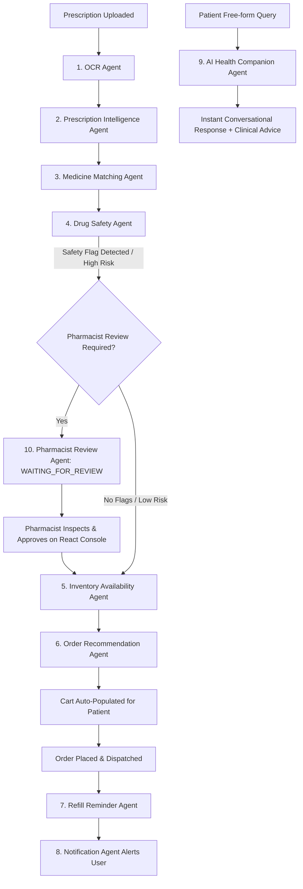

# 📋 MediLoop — Master Implementation Plan

> **Project**: MediLoop — Agentic AI Healthcare & Autonomous Pharmacy Platform  
> **Architecture**: FastAPI (Backend) + PostgreSQL 16 (Database) + 10-Agent AI Engine (LangGraph/Async) + Flutter (Patient Mobile App) + React (Pharmacist Operations Console)  
> **Status**: Production Ready / General Availability (v1.0.0)

---

## 📑 Table of Contents
1. [Executive Summary & Architecture Blueprint](#1-executive-summary--architecture-blueprint)
2. [Work Breakdown Structure (WBS) by Layer](#2-work-breakdown-structure-wbs-by-layer)
   - [2.1 Backend Data & ORM Models](#21-backend-data--orm-models)
   - [2.2 Core REST API Services](#22-core-rest-api-services)
   - [2.3 Multi-Agent AI Workflow Engine (10 Agents)](#23-multi-agent-ai-workflow-engine-10-agents)
   - [2.4 Flutter Mobile Client (Patient Portal)](#24-flutter-mobile-client-patient-portal)
   - [2.5 React Pharmacist Dashboard (Operations Console)](#25-react-pharmacist-dashboard-operations-console)
3. [End-to-End Phased Implementation Schedule](#3-end-to-end-phased-implementation-schedule)
   - [Phase 1: Database Architecture & Core API Setup](#phase-1-database-architecture--core-api-setup)
   - [Phase 2: Autonomous Multi-Agent AI Pipeline](#phase-2-autonomous-multi-agent-ai-pipeline)
   - [Phase 3: React Pharmacist Operations Console](#phase-3-react-pharmacist-operations-console)
   - [Phase 4: Flutter Patient Mobile Experience](#phase-4-flutter-patient-mobile-experience)
   - [Phase 5: Production Security, Audit & DevOps Infrastructure](#phase-5-production-security-audit--devops-infrastructure)
   - [Phase 6: Quality Assurance, Benchmarks & Verification](#phase-6-quality-assurance-benchmarks--verification)
4. [Agentic AI Pipeline Data Flow & State Machine](#4-agentic-ai-pipeline-data-flow--state-machine)
5. [Milestones, Sprint Timeline & Deliverables Matrix](#5-milestones-sprint-timeline--deliverables-matrix)
6. [Risk Management, Compliance & Mitigation Strategy](#6-risk-management-compliance--mitigation-strategy)
7. [Future Roadmap (v1.1 – v2.0)](#7-future-roadmap-v11--v20)

---

## 1. Executive Summary & Architecture Blueprint

MediLoop is an end-to-end intelligent healthcare delivery platform that automates the prescription-to-delivery lifecycle while keeping licensed pharmacists in control via human-in-the-loop (HITL) review gates.

```text
┌─────────────────────────────────────────────────────────────┐
│                    Patient Mobile App                       │
│                     (Flutter 3.29)                          │
└──────────────────────────────┬──────────────────────────────┘
                               │ HTTPS / JSON REST
                               ▼
┌─────────────────────────────────────────────────────────────┐
│              Nginx Gateway Reverse Proxy (Port 80)          │
└──────────────┬──────────────────────────────┬───────────────┘
               │                              │
               ▼                              ▼
┌──────────────────────────────┐ ┌────────────────────────────┐
│   React Dashboard (Port 80)  │ │   FastAPI Core Engine      │
│     (Pharmacist Console)     │ │        (Port 8000)         │
└──────────────────────────────┘ └─────────────┬──────────────┘
                                               │
               ┌───────────────────────────────┼───────────────────────────────┐
               ▼                               ▼                               ▼
┌──────────────────────────────┐ ┌────────────────────────────┐ ┌──────────────────────────────┐
│    PostgreSQL 16 Database    │ │   10-Agent AI Pipeline     │ │   Encrypted File Storage     │
│   (Normalized Relational)    │ │ (Async State Orchestrator) │ │  (10MB Sanitized Presc. Img) │
└──────────────────────────────┘ └────────────────────────────┘ └──────────────────────────────┘
```

---

## 2. Work Breakdown Structure (WBS) by Layer

### 2.1 Backend Data & ORM Models (`backend/app/models/`)
- `user.py`: Patient credentials, profile fields, gender, relation, status flags.
- `address.py`: Multi-address book (home, work, default flag) with geo-coordinates.
- `medical_info.py`: Allergies (e.g., Penicillin, NSAIDs), chronic conditions, and clinical notes.
- `emergency_contact.py`: Primary and secondary emergency contacts with telephone validation.
- `pharmacy.py`: Registered dispensing pharmacies, operating hours, geolocation, and license ID.
- `pharmacist.py`: Pharmacist user profiles, license credentials, and pharmacy association.
- `medicine.py`: Master drug formulary, generic composition, dosage forms, manufacturer, and pricing.
- `pharmacy_inventory.py`: Real-time stock levels, batch numbers, SKU tracking, and expiry dates.
- `prescription.py`: Upload metadata, OCR raw text, extracted items, AI safety flags, and review status.
- `cart.py`: Active session cart, items, selected pharmacy, and applied discounts.
- `order.py`: Order lifecycle (`PLACED`, `PREPARING`, `DISPATCHED`, `DELIVERED`, `CANCELLED`), timestamps, and payment status.

### 2.2 Core REST API Services (`backend/app/api/`)
- `auth.py`: JWT generation, password hashing (`bcrypt`), login, registration, and refresh.
- `users.py` & `profile.py`: Profile updates, medical history CRUD, address management.
- `prescriptions.py`: Multi-part image/PDF upload (<=10MB), MIME verification, workflow trigger.
- `medicines.py`: Fast catalog queries, autocomplete, category filtering, and item details.
- `inventory.py`: Pharmacist inventory management, stock increment/decrement, batch auditing.
- `cart.py`: Cart item management, automated refill cart population.
- `orders.py`: Order creation, checkout, delivery updates, and customer purchase history.
- `pharmacies.py` & `pharmacists.py`: Store directory, pharmacist authorization, and assignment.
- `ai.py`: AI companion chat endpoint (`/ai/chat`), telemetry (`/ai/telemetry`), and workflow resumption.

### 2.3 Multi-Agent AI Workflow Engine (`backend/app/agents/`)
1. **OCR Agent**: Image preprocessing, noise reduction, and text extraction with confidence scoring.
2. **Prescription Intelligence Agent**: Medical entity extraction (drug names, strengths, dosages, frequency).
3. **Medicine Matching Agent**: Levenshtein / fuzzy string matching linking parsed names to database SKUs.
4. **Drug Safety Agent**: Evaluates patient allergy profiles, contraindications, and maximum safe dosages.
5. **Inventory Availability Agent**: Verifies stock availability and batch validity across participating pharmacies.
6. **Order Recommendation Agent**: Compiles suggested cart items, checks pricing, and applies discounts.
7. **Refill Reminder Agent**: Analyzes dosage regimens, predicts depletion dates, and schedules reminders.
8. **Notification Agent**: Dispatches multi-channel alerts (in-app notifications, SMS, push notifications).
9. **AI Health Companion Agent**: Clinical FAQ responder with medical safety disclaimers.
10. **Pharmacist Review Agent**: State-machine manager handling `WAITING_FOR_REVIEW` pauses and HITL approvals.

### 2.4 Flutter Mobile Client (`lib/`)
- **State Management & Routing**: Provider pattern with central routes in `app_routes.dart`.
- **Theme & Design**: Custom Material 3 glassmorphic design system in `app_theme.dart`.
- **Authentication**: `LoginScreen`, `RegisterScreen`, and `ForgotPasswordScreen`.
- **Home & Discovery**: `HomeScreen` with AI quick ordering, category chips, and prescription CTA.
- **Prescription Upload**: `UploadPrescriptionScreen` with camera/gallery picker and processing tracker.
- **Search & Details**: `SearchMedicinesScreen` and `MedicineDetailsScreen`.
- **Cart & Checkout**: `CartScreen`, `PaymentScreen`, and `OrderSuccessScreen`.
- **Tracking & Reminders**: `OrderTrackingScreen` with timeline steps, and `NotificationsScreen`.
- **AI Companion**: `AIChatScreen` with conversational bubble UI and structured recommendations.
- **Profile & Health Info**: `ProfileScreen` with allergy tags, medical history, and emergency contacts.

### 2.5 React Pharmacist Dashboard (`pharmacy dashboard/`)
- **Authentication**: Pharmacist credentials and license verification.
- **Live Orders Desk**: Real-time order stream with status transition controls.
- **Prescription Review Console**: Human-in-the-Loop review showing OCR text, matched SKUs, and safety alerts.
- **Inventory Control**: Real-time stock CRUD, batch expiration alerts, and price editing.
- **Analytics & Telemetry**: Order metrics, AI processing latency, and intervention audit logs.

---

## 3. End-to-End Phased Implementation Schedule

### Phase 1: Database Architecture & Core API Setup
- **Milestone 1.1**: Design PostgreSQL schema with foreign keys, indexes, and constraints.
- **Milestone 1.2**: Implement SQLAlchemy ORM models with audit timestamps.
- **Milestone 1.3**: Build Pydantic validation schemas with input sanitization.
- **Milestone 1.4**: Configure FastAPI application structure, CORS, security headers, and rate limiting.
- **Milestone 1.5**: Implement JWT authentication, password hashing (`bcrypt`), and role guards.

### Phase 2: Autonomous Multi-Agent AI Pipeline
- **Milestone 2.1**: Implement `BaseAgent`, `AgentContext`, and execution logger.
- **Milestone 2.2**: Integrate `OCRAgent` with confidence scoring and fallback text cleaning.
- **Milestone 2.3**: Build regex & NER medical parsing in `PrescriptionIntelligenceAgent`.
- **Milestone 2.4**: Implement fuzzy string matching in `MedicineMatchingAgent`.
- **Milestone 2.5**: Develop clinical safety checks in `DrugSafetyAgent` (allergies & contraindications).
- **Milestone 2.6**: Connect `InventoryAvailabilityAgent` and `OrderRecommendationAgent`.
- **Milestone 2.7**: Build `PharmacistReviewAgent` state machine for human-in-the-loop review.
- **Milestone 2.8**: Implement `WorkflowEngine` orchestrator connecting all 10 agents asynchronously.

### Phase 3: React Pharmacist Operations Console
- **Milestone 3.1**: Scaffold React 18 + Vite project with Lucide icons and Axios client.
- **Milestone 3.2**: Build Pharmacist Auth and Protected Route guards.
- **Milestone 3.3**: Develop Live Orders Console with real-time status transitions.
- **Milestone 3.4**: Create Prescription Manual Review Desk with visual safety badges and approval actions.
- **Milestone 3.5**: Implement Inventory CRUD management with stock threshold highlights.

### Phase 4: Flutter Patient Mobile Experience
- **Milestone 4.1**: Set up Flutter Material 3 glassmorphic design theme and responsive typography.
- **Milestone 4.2**: Implement User Authentication, Token Persistence, and Auto-login.
- **Milestone 4.3**: Build Profile Screen with Medical History and Allergy tag management.
- **Milestone 4.4**: Build Prescription Scanner with image validation (<=10MB) and camera integration.
- **Milestone 4.5**: Implement Medicine Catalog search, filter chips, and detailed drug info views.
- **Milestone 4.6**: Build Shopping Cart, Address Selector, Payment Simulation, and Order Tracking.
- **Milestone 4.7**: Implement interactive `AIChatScreen` connected to `/api/v1/ai/chat`.

### Phase 5: Production Security, Audit & DevOps Infrastructure
- **Milestone 5.1**: Enforce file upload security (10MB maximum limit, MIME inspection, sanitized paths).
- **Milestone 5.2**: Implement sliding-window rate limiting middleware for brute-force protection.
- **Milestone 5.3**: Set up multi-stage containerization with `docker-compose.yml` (Postgres, FastAPI, React, Nginx).
- **Milestone 5.4**: Configure Nginx reverse proxy routing (`/` -> React, `/api` -> FastAPI, `/uploads` -> Static).
- **Milestone 5.5**: Write automated database and media backup shell scripts (`scripts/backup_db.sh`).

### Phase 6: Quality Assurance, Benchmarks & Verification
- **Milestone 6.1**: Backend Pytest test suite covering all 10 agents, edge cases, and security vulnerabilities.
- **Milestone 6.2**: Flutter test suite covering widget rendering, profile management, and auth services.
- **Milestone 6.3**: React dashboard build verification and lint checks.
- **Milestone 6.4**: Execute 12-step end-to-end UAT demonstration script (`DEMO_SCRIPT.md`).

---

## 4. Agentic AI Pipeline Data Flow & State Machine



---

## 5. Milestones, Sprint Timeline & Deliverables Matrix

| Sprint | Focus Area | Key Deliverables | Verification Criteria |
| :--- | :--- | :--- | :--- |
| **Sprint 1** | Foundation & Data Layer | PostgreSQL 16 schema, SQLAlchemy models, Pydantic schemas, Auth endpoints | All models migrated; JWT issue & verify pass |
| **Sprint 2** | AI Agents & Workflow Engine | 10 agents implemented, LangGraph-style async orchestrator, safety logic | 16/16 backend unit & agent tests pass |
| **Sprint 3** | Operations Dashboard | React 18 dashboard, review console, live order manager, inventory CRUD | Clean build (0 errors); manual review test |
| **Sprint 4** | Flutter Mobile App | 16 Flutter screens, Provider state management, API services, prescription upload | Flutter test suite passes; APK/Web builds cleanly |
| **Sprint 5** | Integration & HITL Loop | Full integration between Flutter, Backend, AI Engine, and React Dashboard | End-to-end order & prescription flow complete |
| **Sprint 6** | Security & Production Ops | Rate limiting, 10MB file limit, Docker compose stack, Nginx gateway, backups | All containers healthy; backup script dumps DB |
| **Sprint 7** | UAT & Final Release | End-to-end 12-step demonstration walkthrough, telemetry audit, documentation | Zero critical defects; v1.0.0 GA tagged |

---

## 6. Risk Management, Compliance & Mitigation Strategy

| Risk Category | Identified Risk | Impact | Mitigation Strategy |
| :--- | :--- | :--- | :--- |
| **Clinical Safety** | OCR misreads drug strength or name | High | Human-in-the-Loop review (`WAITING_FOR_REVIEW`) triggers automatically whenever OCR confidence < 80% or clinical flags arise. |
| **Drug Interactions** | Patient has undisclosed allergy | High | Mandatory allergy profile prompt upon registration; drug-drug interaction matrix validated before checkout. |
| **Security / PHI** | Unauthorized prescription access | Critical | JWT bearer authentication with role guards; uploaded images stored in non-public directories with UUID obfuscation. |
| **Inventory Racing** | Concurrent orders exceed stock | Medium | Database row-level locks on stock decrement during order placement; real-time inventory re-verification at checkout. |
| **API Denial of Service** | Abuse of AI endpoints | Medium | IP-based sliding window rate limiter middleware (60 req/min general, 10 req/min AI endpoints). |

---

## 7. Future Roadmap (v1.1 – v2.0)

- **v1.1**: Voice-to-text prescription dictation; multilingual AI Companion Chat (Hindi, Spanish, French); advanced contrast/rotation image preprocessing.
- **v1.2**: Apple Health / Google Fit wearable integration; automated weekly adherence reporting; prescriber doctor verification portal.
- **v2.0**: Integrated WebRTC telemedicine consultations; AI clinical symptom triage; FHIR/HL7 electronic health record (EHR) interoperability.
