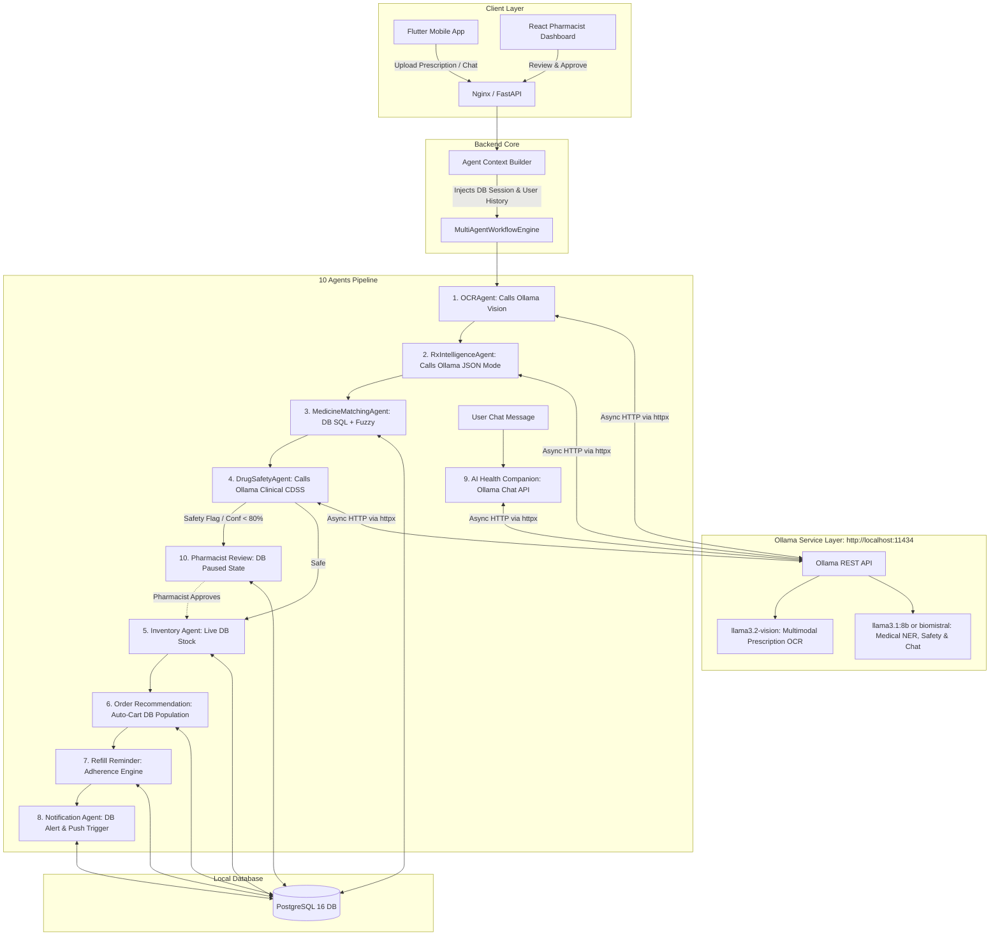

# 🦙 MediLoop — Ollama Local AI Multi-Agent Implementation Plan

> **Decision**: All 10 AI Agents in MediLoop will be powered by **Ollama** running locally/on-premise, providing **100% free**, **offline**, **private**, and **HIPAA-compliant** inference without external API costs.

---

## 1. Ollama Model Architecture Mapping

| # | Agent Name | Ollama Model | Responsibility & Implementation |
|---|---|---|---|
| **1** | [**`OCRAgent`**](file:///c:/Users/SHIVANI/AndroidStudioProjects/mediloop/backend/app/agents/ocr_agent.py) | `llama3.2-vision` (or `llava`) | Takes binary prescription image (.jpg, .png), encodes to Base64, prompts model to extract all handwritten/typed lines verbatim. |
| **2** | [**`PrescriptionIntelligenceAgent`**](file:///c:/Users/SHIVANI/AndroidStudioProjects/mediloop/backend/app/agents/prescription_agent.py) | `llama3.1:8b` (or `biomistral:7b`) | Performs Medical Named Entity Recognition (NER) via Ollama JSON mode (`format="json"`), extracting drug names, strengths, dosages, frequencies, and durations. |
| **3** | [**`MedicineMatchingAgent`**](file:///c:/Users/SHIVANI/AndroidStudioProjects/mediloop/backend/app/agents/medicine_matching_agent.py) | PostgreSQL + `llama3.1:8b` (fallback) | Queries live `Medicine` and `PharmacyInventory` in PostgreSQL using hybrid SQL `ILIKE` and Levenshtein fuzzy matching; uses Ollama to resolve medical abbreviations (e.g. "PCM" -> "Paracetamol"). |
| **4** | [**`DrugSafetyAgent`**](file:///c:/Users/SHIVANI/AndroidStudioProjects/mediloop/backend/app/agents/drug_safety_agent.py) | `biomistral:7b` (or `llama3.1:8b`) | Ingests patient `MedicalInfo` (allergies, chronic illnesses) and evaluates matched drugs for drug-drug interactions, contraindications, and dosage caps. |
| **5** | [**`InventoryAvailabilityAgent`**](file:///c:/Users/SHIVANI/AndroidStudioProjects/mediloop/backend/app/agents/inventory_agent.py) | Real-time PostgreSQL SQL | Queries `Pharmacy` and `PharmacyInventory` tables for physical stock counts, batch expiry validity (> 30 days), and proximity routing. |
| **6** | [**`OrderRecommendationAgent`**](file:///c:/Users/SHIVANI/AndroidStudioProjects/mediloop/backend/app/agents/order_recommendation_agent.py) | Heuristic Optimizer + DB | Evaluates price, distance, and generic bio-equivalents; **auto-populates the customer's active `Cart` in PostgreSQL**. |
| **7** | [**`RefillReminderAgent`**](file:///c:/Users/SHIVANI/AndroidStudioProjects/mediloop/backend/app/agents/refill_reminder_agent.py) | Database Adherence Engine | Calculates medication exhaustion dates from past `Order` and `OrderItem` records; schedules proactive refill alerts. |
| **8** | [**`NotificationAgent`**](file:///c:/Users/SHIVANI/AndroidStudioProjects/mediloop/backend/app/agents/notification_agent.py) | PostgreSQL Dispatcher | Inserts notification records into PostgreSQL `Notification` table; dispatches push alerts to Flutter and dashboard alerts to React. |
| **9** | [**`AIHealthCompanionAgent`**](file:///c:/Users/SHIVANI/AndroidStudioProjects/mediloop/backend/app/agents/health_companion_agent.py) | `llama3.1:8b` (or `biomistral:7b`) | Multi-turn conversational health assistant with clinical safety guardrails, disclaimer disclaimers, and contextual tool-calling into inventory and orders. |
| **10**| **Pharmacist Review Agent** ([`workflow_engine.py`](file:///c:/Users/SHIVANI/AndroidStudioProjects/mediloop/backend/app/agents/workflow_engine.py)) | PostgreSQL HITL State Machine | Pauses workflow (`WAITING_FOR_REVIEW`) if OCR confidence < 80% or clinical flags are detected; pushes live review card to React Pharmacist Console. |

---

## 2. Ollama Integration Architecture



---

## 3. Step-by-Step Implementation Roadmap

### Step 1: Ollama Setup & Model Pulling
1. Download & Install Ollama for Windows: [https://ollama.com/download/windows](https://ollama.com/download/windows).
2. Pull the required models:
   ```powershell
   ollama pull llama3.2-vision
   ollama pull llama3.1:8b
   # Optional specialized medical model:
   ollama pull biomistral:7b
   ```
3. Verify Ollama is running at `http://localhost:11434`.

### Step 2: Build `OllamaClient` Service (`backend/app/core/ollama_client.py`)
- High-performance, asynchronous client using `httpx` (already in the Python environment).
- Features:
  - `generate_vision(image_bytes, prompt)` ➔ calls `/api/generate` with Base64 image payload.
  - `generate_json(prompt, schema)` ➔ calls `/api/generate` with `format="json"`.
  - `chat(messages, system_prompt)` ➔ calls `/api/chat`.
  - Graceful connection check & fallback handling if Ollama is starting up.

### Step 3: Inject Database Session into `AgentContext`
- Modify `backend/app/agents/context.py` to accept and hold an active SQLAlchemy `Session`.
- Enables Agents 3, 5, 6, 7, 8, 10 to perform live database queries instead of using mock dictionaries.

### Step 4: Implement Real-Time Agent Logic

#### Agent 1: OCR Agent (`ocr_agent.py`)
- Replace the file reading fallback with `OllamaVisionProvider`.
- Reads binary image from `image_path`, converts to Base64, and calls `llama3.2-vision`.
- Returns raw extracted lines, optical confidence, and text verbatim.

#### Agent 2: Prescription Intelligence Agent (`prescription_agent.py`)
- Prompts Ollama with the extracted prescription text and asks for strict JSON:
  ```json
  {
    "medicines": [
      {
        "name": "Amoxicillin",
        "strength": "500mg",
        "dosage": "1 capsule",
        "frequency": "BID (twice daily)",
        "duration": "7 days",
        "instructions": "After meals"
      }
    ],
    "doctor_notes": "Take with plenty of water"
  }
  ```

#### Agent 3: Medicine Matching Agent (`medicine_matching_agent.py`)
- Queries PostgreSQL `Medicine` table.
- Matches extracted names against brand and generic columns.
- Uses Ollama only to resolve abbreviations (e.g. "PCM" ➔ "Paracetamol") when database fuzzy score is borderline.

#### Agent 4: Drug Safety Agent (`drug_safety_agent.py`)
- Loads patient's allergies and chronic conditions from `MedicalInfo`.
- Prompts `biomistral` / `llama3.1` to evaluate matched medicines for drug-drug interactions, contraindications, and maximum safe dosages.
- Automatically flags `WAITING_FOR_REVIEW` for the Pharmacist Review Agent if risk is `HIGH` or `CRITICAL`.

#### Agent 5: Inventory Availability Agent (`inventory_agent.py`)
- Replaces `PHARMACY_INVENTORY` mock with real-time SQL queries against `PharmacyInventory`.
- Verifies stock quantity and checks batch expiration (`expiry_date > today + 30 days`).

#### Agent 6: Order Recommendation Agent (`order_recommendation_agent.py`)
- Compiles best pharmacy recommendations and **inserts/updates customer active `Cart` in PostgreSQL**.

#### Agent 7: Refill Reminder Agent (`refill_reminder_agent.py`)
- Inspects completed orders in database and projects precise medicine depletion dates.

#### Agent 8: Notification Agent (`notification_agent.py`)
- Inserts notification records into PostgreSQL `Notification` table for the customer.

#### Agent 9: AI Health Companion Agent (`health_companion_agent.py`)
- Connects `/api/v1/ai/chat` to Ollama's `/api/chat` endpoint.
- Maintains multi-turn conversation memory with strict clinical disclaimers.

#### Agent 10: Pharmacist Review Agent (`workflow_engine.py`)
- Persists workflow state in the database, allowing the React Pharmacist Dashboard to review, approve, and resume execution.

---

## 4. Configuration Template (`backend/.env`)

```env
# Ollama Configuration
OLLAMA_BASE_URL=http://localhost:11434
OLLAMA_VISION_MODEL=llama3.2-vision
OLLAMA_CHAT_MODEL=llama3.1:8b
OLLAMA_MEDICAL_MODEL=biomistral:7b
OLLAMA_TIMEOUT_SECONDS=60
```

---

## 5. Verification & Testing Protocol

1. **Ollama Service Health Test**: `GET http://localhost:11434/api/tags` returns available models.
2. **Prescription Upload Test**: Upload dummy prescription image; verify `llama3.2-vision` extracts text and `llama3.1` parses structured entities.
3. **Database Integration Test**: Verify matched items pull real IDs from PostgreSQL and populate the patient's cart.
4. **Health Chat Test**: Query `/api/v1/ai/chat` and verify real-time response from local Ollama model.
