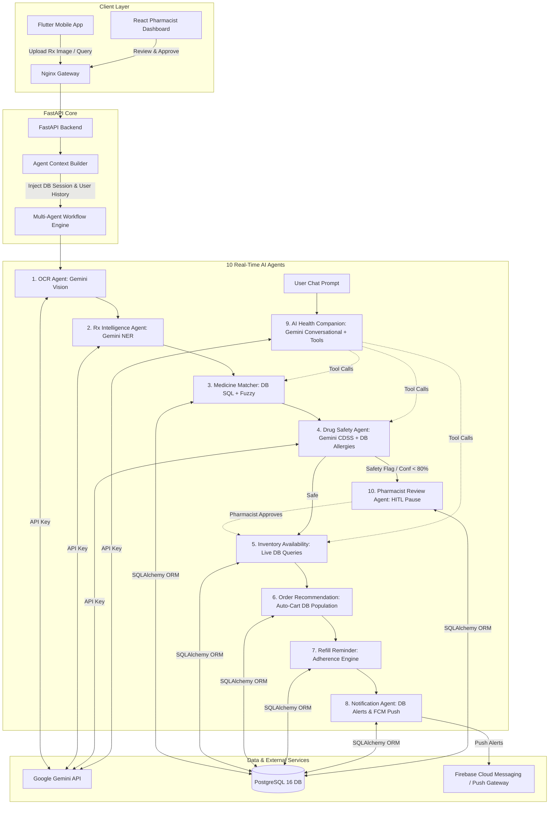

# 🤖 MediLoop Real-Time Multi-Agent AI Implementation Plan

> **Objective**: Migrate the 10 MediLoop AI agents from mock heuristics and hardcoded dictionaries to real-time multimodal LLMs (Google Gemini), dynamic PostgreSQL database queries, clinical safety APIs, and asynchronous push notification dispatchers.

---

## 1. Executive Transformation Matrix

| # | Agent Name | Current State (Hardcoded / Mock) | Real-Time Target Architecture | Technology & Data Source |
|---|---|---|---|---|
| **1** | **OCR Agent** | Reads file as UTF-8 string; falls back to static 8-line dummy doctor Rx. | Multimodal Vision OCR extraction supporting raw JPG, PNG, and PDF prescription scans. | **Gemini 1.5 / 2.0 Flash Vision** (or Tesseract fallback), OpenCV preprocessing. |
| **2** | **Prescription Intelligence Agent** | Hardcoded regex matching for strength/frequency; skips noisy lines. | LLM-based Medical Named Entity Recognition (NER), dosage normalization, and extraction. | **Gemini Structured Output** (`pydantic` JSON schema for Rx entities). |
| **3** | **Medicine Matching Agent** | Static array of 14 medicines (`MEDILOOP_CATALOG`) and static abbreviation map. | Live PostgreSQL database search with hybrid fuzzy matching + semantic vector embeddings. | Live `Medicine` & `PharmacyInventory` DB queries, `thefuzz` / Levenshtein, pgvector / embeddings. |
| **4** | **Drug Safety Agent** | Static list of 5 drug interactions and 4 allergy cross-reactivity sets. | Dynamic patient history inspection + LLM clinical decision support system (CDSS). | Patient `MedicalInfo` in DB + **Gemini Clinical Safety Prompt** (RxNorm / OpenFDA knowledge). |
| **5** | **Inventory Availability Agent** | In-memory dictionary of 3 dummy pharmacies and hardcoded stock counts. | Real-time SQL queries across registered pharmacies, batch expiry checks, and geo-routing. | Live `Pharmacy` & `PharmacyInventory` PostgreSQL records, Geo-distance / Haversine formula. |
| **6** | **Order Recommendation Agent** | Rule-based heuristic sorting over dummy inventory. | Multi-objective optimization (cost, distance, stock completeness) + generic substitution. | Dynamic pricing & inventory evaluation, auto-populating active customer `Cart` in PostgreSQL. |
| **7** | **Refill Reminder Agent** | Hardcoded set of 14 chronic drugs and basic date arithmetic. | Prescription regimen timeline modeling + historical order adherence risk profiling. | Past `Order` & `OrderItem` records in DB, automated background scheduler (`APScheduler`). |
| **8** | **Notification Agent** | Returns in-memory dictionary payload without persistence or delivery. | Multi-channel dispatch engine persisting notifications in DB and sending push alerts. | PostgreSQL `Notification` table + Firebase Cloud Messaging (FCM) / Webhooks. |
| **9** | **AI Health Companion Agent** | Simple keyword search (`if 'safe' in msg`) with canned template responses. | Multi-turn conversational AI companion with system prompt guardrails and tool calling. | **Gemini 1.5 / 2.0 Flash** with tool-calling to Agents 3, 4, 5, 7 and conversation memory. |
| **10**| **Pharmacist Review Agent** | In-memory workflow pause state. | Persistent review state machine in PostgreSQL, real-time alert dispatch to React Dashboard. | `Prescription` review state (`WAITING_FOR_REVIEW`), WebSocket / SSE events to React console. |

---

## 2. Architecture & Data Flow



---

## 3. Detailed Agent-by-Agent Implementation Specifications

### Agent 1: Real-Time OCR Agent (`ocr_agent.py`)
- **Current Limitation**: Attempts to read binary JPEG/PNG with `open(..., 'r')`, throwing errors and falling back to a static 8-line string.
- **Real-Time Implementation**:
  - Integrate `GeminiVisionOCRProvider` implementing `BaseOCRProvider`.
  - Read binary image bytes and encode as Base64 or pass directly via the Google GenAI SDK.
  - Prompt: Extract every visible prescription text line verbatim with confidence annotations and orientation correction.
  - Return: Structured lines, raw text, detected language, and calculated confidence score.
  - Fallback: Local Tesseract OCR (if installed) or clean error reporting without synthetic hallucinations.

### Agent 2: Prescription Intelligence Agent (`prescription_agent.py`)
- **Current Limitation**: Relies on basic regexes (`\b\d+mg\b`, `\b[01]-[01]-[01]\b`), failing on messy doctor handwriting, unformatted doctor notes, or Latin abbreviations.
- **Real-Time Implementation**:
  - Use **Gemini Structured Output** (`response_format={"type": "json_object"}`) or Pydantic schema validation.
  - Schema:
    ```json
    {
      "medicines": [
        {
          "extracted_name": "Amoxil",
          "generic_name": "Amoxicillin",
          "strength": "500 mg",
          "form": "capsule",
          "dosage": "1 cap",
          "frequency": "BID",
          "duration": "7 days",
          "instructions": "After meals",
          "quantity": 14,
          "confidence": 0.95
        }
      ],
      "doctor_notes": "Take with plenty of water",
      "diagnosis": "Bacterial upper respiratory infection"
    }
    ```
  - Eliminates fragile regex patterns and handles handwritten doctor notation variations.

### Agent 3: Medicine Matching Agent (`medicine_matching_agent.py`)
- **Current Limitation**: Matches against a hardcoded list of 14 static items in `MEDILOOP_CATALOG`.
- **Real-Time Implementation**:
  - Inject database session (`db: Session`) into `AgentContext`.
  - Query the live `Medicine` table in PostgreSQL.
  - Multi-tier matching pipeline:
    1. **Exact Brand/Generic Match**: SQL `ILIKE` on `brand_name` and `generic_name`.
    2. **Fuzzy String Matching**: `difflib.SequenceMatcher` or `thefuzz` over all active DB catalog names (threshold >= 0.75).
    3. **LLM Semantic Fallback**: Ask Gemini to disambiguate trade names, regional brand variations, or shorthand (e.g., "PCM 650" -> "Paracetamol 650mg").
  - Returns actual database medicine records, verified pricing, and SKU metadata.

### Agent 4: Drug Safety Agent (`drug_safety_agent.py`)
- **Current Limitation**: Only checks 5 hardcoded drug-drug pairs and 4 static allergy groups.
- **Real-Time Implementation**:
  - Pull patient's real medical history from database: `MedicalInfo` (allergies, chronic conditions, pregnancy, age).
  - Construct a clinical safety prompt for Gemini with strict medical decision support system (CDSS) guardrails:
    - Input: Extracted/matched medicines + Patient known allergies + Pre-existing medical conditions.
    - Evaluate: Drug-drug interactions, allergy cross-sensitivities, duplicate active ingredients (e.g., Crocin + Calpol both containing Paracetamol), and maximum safe daily dosage.
    - Output: Clinical severity (`INFO`, `LOW`, `MEDIUM`, `HIGH`, `CRITICAL`), clinical rationale, and actionable pharmacist recommendation.
  - Automatically set `context.requires_pharmacist_review = True` if any `HIGH` or `CRITICAL` risk is detected.

### Agent 5: Inventory Availability Agent (`inventory_agent.py`)
- **Current Limitation**: Uses static dictionary `PHARMACY_INVENTORY` for 3 dummy pharmacies.
- **Real-Time Implementation**:
  - Query real `Pharmacy` and `PharmacyInventory` tables.
  - Check stock availability (`PharmacyInventory.stock_quantity >= item.quantity`).
  - Filter out expired or near-expiry batches (`expiry_date <= today + 30 days`).
  - Calculate distance from user's active delivery address to each pharmacy using Haversine formula.
  - Return optimal pharmacy or multi-pharmacy fulfillment options.

### Agent 6: Order Recommendation Agent (`order_recommendation_agent.py`)
- **Current Limitation**: Static heuristics without database persistence.
- **Real-Time Implementation**:
  - Compute best pricing and fulfillment speed across in-stock pharmacies.
  - Check for lower-cost generic alternatives in the DB (e.g., generic Paracetamol vs expensive branded Crocin) and propose substitutions.
  - **Auto-populate Database Cart**: Directly insert or update items into the customer's active `Cart` and `CartItem` in PostgreSQL so they immediately appear in the Flutter mobile app.

### Agent 7: Refill Reminder Agent (`refill_reminder_agent.py`)
- **Current Limitation**: Static set of 14 chronic drugs with fixed 30-day assumption.
- **Real-Time Implementation**:
  - Query patient's past completed orders (`Order` and `OrderItem`) in PostgreSQL.
  - Parse prescribed dosage regimen to calculate precise exhaustion date:  
    $$\text{Days Supply} = \frac{\text{Total Quantity Dispensed}}{\text{Daily Dose Frequency}}$$
  - Determine adherence score and schedule proactive refill triggers 5 days before stock depletion.
  - Integrate with background task scheduler (`APScheduler` or Celery/FastAPI background tasks).

### Agent 8: Notification Agent (`notification_agent.py`)
- **Current Limitation**: Generates an in-memory dictionary that disappears after execution.
- **Real-Time Implementation**:
  - **Database Persistence**: Insert record into PostgreSQL `Notification` table with `is_read = False`.
  - **Push Notification Service**: Integrate Firebase Cloud Messaging (FCM) to trigger instant notification banners on the patient's Flutter mobile device.
  - **Pharmacist Alert**: Send WebSocket or server-sent event (SSE) to the React Pharmacist Dashboard when a prescription requires review.

### Agent 9: AI Health Companion Agent (`health_companion_agent.py`)
- **Current Limitation**: Hardcoded keyword matching (`'safe'`, `'stock'`, `'order'`) with canned replies.
- **Real-Time Implementation**:
  - Gemini Conversational Engine with system prompt defining clinical tone, safety boundaries, and disclaimers.
  - **Multi-Turn Memory**: Maintain chat session history per user in the database or Redis.
  - **Tool / Function Calling**: Provide the AI model access to tools:
    - `check_medicine_stock(medicine_name)`
    - `check_drug_safety(medicine_names, user_id)`
    - `get_user_active_prescriptions(user_id)`
    - `track_order_status(order_id)`
  - Direct contextual assistance linking user questions to specific actions in the mobile app.

### Agent 10: Pharmacist Review Agent (`workflow_engine.py` / HITL)
- **Current Limitation**: Ephemeral in-memory pause that cannot survive server restarts.
- **Real-Time Implementation**:
  - Persist workflow state in PostgreSQL `Prescription` table (`status = WAITING_FOR_REVIEW`, `workflow_id = uuid`).
  - Expose review queue endpoint (`GET /api/v1/prescriptions/pending-review`) for the React dashboard.
  - Enable `/api/v1/ai/resume-workflow` to inject pharmacist edits/approvals, resuming the workflow from Agent 5 (Inventory) through Agent 8 (Notification).

---

## 4. Phase-by-Phase Execution Plan

### Phase 1: AI Client & Database Bridge Infrastructure (Days 1–2)
1. **Gemini Service Module**: Create `backend/app/core/ai_client.py` using `google-genai` / `httpx` to handle rate limits, retries, and API key management from `.env`.
2. **Context Database Injection**: Update `AgentContext` in `backend/app/agents/context.py` to hold an active SQLAlchemy `db: Session`.
3. **Database Seeding**: Ensure realistic medicine and inventory data is seeded in PostgreSQL.

### Phase 2: Vision & Extraction Pipeline (Days 3–4)
1. **Agent 1 (OCR)**: Connect `MedicalVisionOCRProvider` to Gemini Vision API; handle multi-format image uploads (JPEG/PNG/PDF).
2. **Agent 2 (Rx Intelligence)**: Replace regex parsing with Gemini Structured Output schema for high-accuracy medical entity extraction.
3. **Agent 3 (Medicine Matching)**: Replace `MEDILOOP_CATALOG` with dynamic database queries and hybrid fuzzy matching.

### Phase 3: Clinical Safety & Live Logistics (Days 5–6)
1. **Agent 4 (Drug Safety)**: Wire `DrugSafetyAgent` to pull live patient `MedicalInfo` and run real-time CDSS checks via Gemini.
2. **Agent 5 (Inventory)**: Wire `InventoryAvailabilityAgent` to query `PharmacyInventory` in PostgreSQL with real stock & expiration filters.
3. **Agent 6 (Order Recommendation)**: Implement cart auto-population in PostgreSQL so recommendations directly reflect in the mobile app.

### Phase 4: Adherence, Notifications & Health Chat (Days 7–8)
1. **Agent 7 (Refill Reminder)**: Compute real consumption schedules from patient order history.
2. **Agent 8 (Notification)**: Save notifications to PostgreSQL `Notification` table and connect FCM push triggers.
3. **Agent 9 (Health Companion)**: Implement real-time Gemini chat with multi-turn conversation memory and tool calling.

### Phase 5: Human-in-the-Loop & Dashboard Sync (Days 9–10)
1. **Agent 10 (Review State Machine)**: Persist paused workflows in database; emit event to React Dashboard.
2. **Dashboard Verification Desk**: Verify pharmacist approval successfully resumes pipeline and notifies customer.

### Phase 6: Testing, Benchmarks & Validation (Days 11–12)
1. Update existing unit & integration tests (`backend/tests/test_agents_unit.py`) with mock LLM fixtures for CI/CD and live API integration tests for staging.
2. Benchmark latency (target: end-to-end pipeline execution < 4.5 seconds).
3. Validate end-to-end user experience with Flutter mobile app and React dashboard.
